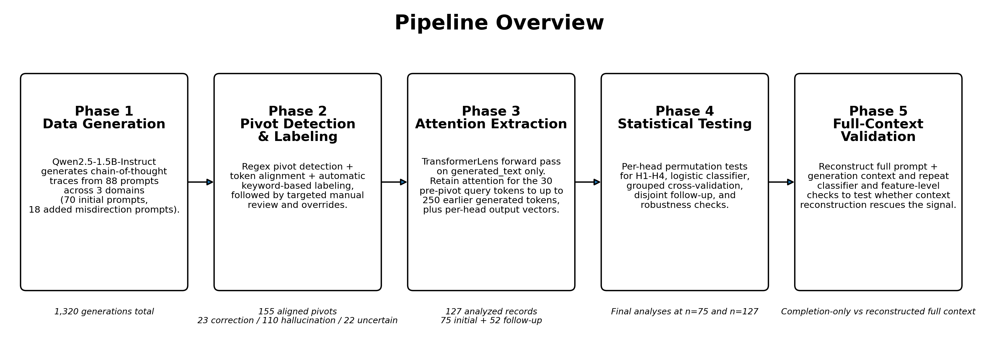
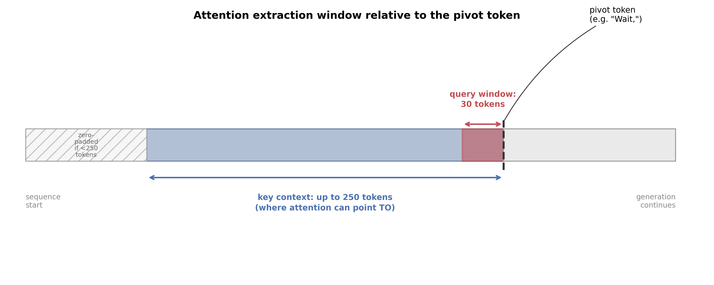
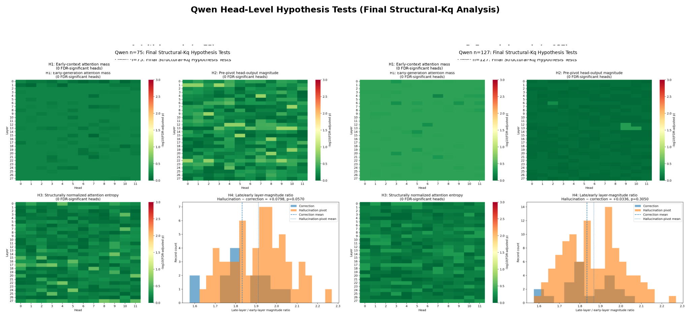
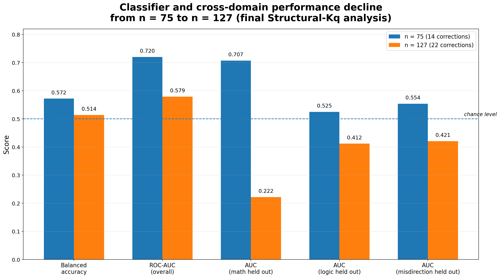
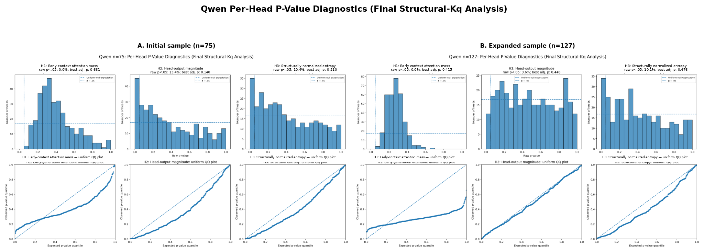

# Attention Pivot Analysis

**Can a language model's internal attention activations distinguish a genuine self-correction from a hallucinated pivot before the pivot is completed?**

This repository contains a reproducible mechanistic-interpretability case study built around that question. The project began with an encouraging result on a small Qwen sample, then deliberately tested whether it survived:

- additional data;
- prompt-grouped evaluation;
- a disjoint later-collected test set;
- reconstructed full-context replay;
- label-sensitivity and ground-truth audits; and
- replication on a second model family, Gemma.

> **Main result:** the initial Qwen signal did not generalize. A class-weighted linear classifier reached ROC-AUC **0.720** on the initial sample (`n=75`), declined to **0.579** after expansion (`n=127`), and reached **0.392** when trained on the initial 75 records and evaluated only on the 52 later-collected records. No per-head H1-H3 result survived false-discovery-rate correction. Reconstructed full context and the Gemma replication did not recover a stable, transferable signal.



---

## Why this project matters

Mechanistic-interpretability studies often test hundreds or thousands of internal features using relatively few labeled examples. In that setting, an apparently strong result can survive ordinary cross-validation while still failing on newly collected data.

This project therefore emphasizes the **validation process**, not just the final negative result:

- define falsifiable hypotheses before inspecting individual heads;
- distinguish exploratory analysis from later follow-up testing;
- correct for testing many heads;
- keep records from the same prompt together during grouped evaluation;
- test on records collected after the initial analysis;
- audit labels and rerun sensitivity analyses;
- test whether missing prompt context explains the result; and
- repeat the analysis on another model family.

The central methodological lesson is simple:

> **Cross-validation within the original sample is not a substitute for testing on deliberately collected follow-up data.**

---

## Research question

Reasoning traces sometimes contain pivots such as:

- *"Wait, actually..."*
- *"I made a mistake..."*
- *"Let me reconsider..."*

Some pivots genuinely repair an earlier mistake. Others abandon a correct or defensible line of reasoning and introduce a new error.

The analysis compares:

- **`correction`** — the pivot repairs an earlier mistake;
- **`hallucination_pivot`** — the pivot moves toward an incorrect conclusion; and
- **`uncertain`** — the pivot cannot be assigned confidently to either class.

`uncertain` records remain in the labeled dataset but are excluded from binary hypothesis tests and classifiers.

---

## Models and datasets

### Qwen

- **Model:** `Qwen/Qwen2.5-1.5B-Instruct`
- **Domains:** math, logic, and misdirection
- **Prompts:** 88
- **Generated traces:** 1,320
- **Aligned pivot records:** 155

Final Qwen label distribution:

| Label | Count |
|---|---:|
| `correction` | 23 |
| `hallucination_pivot` | 110 |
| `uncertain` | 22 |

The completion-only Qwen analyses use:

| Sample | Corrections | Hallucination pivots | Total |
|---|---:|---:|---:|
| Initial sample | 14 | 61 | 75 |
| Expanded sample | 22 | 105 | 127 |
| Later-collected subset | 8 | 44 | 52 |

The expanded sample contains the original 75 records plus 52 later-collected misdirection records. It is a deliberate prospective expansion, not a fully independent replication sample. The later-52 evaluation is disjoint from training but also introduces domain shift.

### Gemma

- **Model:** `google/gemma-2-2b-it`
- **Usable records:** 76
- **Corrections:** 13
- **Hallucination pivots:** 63

Gemma repeats the completion-only, robustness, and reconstructed full-context analyses as a second-model check.

---

## Pipeline

The project is organized into five stages:

1. **Generation** — produce reasoning traces using prompts designed to elicit natural reasoning pivots.
2. **Detection and labeling** — identify pivot phrases, align character spans to model tokens, assign automatic labels, and apply targeted manual review.
3. **Completion-only extraction** — extract attention weights and per-head outputs from generated text.
4. **Statistical analysis and robustness checks** — test four hypotheses, train classifiers, and evaluate generalization.
5. **Reconstructed full-context validation** — replay prompt plus generation under teacher forcing and recompute the same features.

---

## Attention extraction

For each pivot, the Qwen completion-only extraction stores:

- the final **30 query tokens before the pivot**;
- up to **250 earlier generated-text key positions**;
- attention weights for every layer and head; and
- per-head output vectors for the same 30-token query window.

For Qwen, the per-record tensors are:

```text
attention weights:  (28 layers, 12 heads, 30 queries, 250 keys)
head outputs:       (28 layers, 30 queries, 12 heads, 128 dimensions)
```

When fewer than 250 real key positions exist, the tensors are left-padded. When more than 250 exist, the earliest generated tokens are truncated.

The reconstructed full-context notebooks separately rebuild prompt-plus-generation input to test whether completion-only extraction or context truncation explains the result.



---

## Hypotheses and features

| Hypothesis | Feature | Prediction |
|---|---|---|
| **H1: Early-context attention mass** | Attention mass on the first 50 real retained key positions, per head | Corrections attend more strongly to early retained context |
| **H2: Head-output magnitude** | Mean L2 norm of each head's output over the 30 pre-pivot queries | Specific heads activate more strongly before corrections |
| **H3: Structurally normalized attention entropy** | Shannon entropy over real, causally available keys, divided by `log(K_q)` | Corrections exhibit more diffuse attention |
| **H4: Late/early magnitude ratio** | Mean late-layer magnitude divided by mean early-layer magnitude | Hallucination pivots show stronger late-layer dominance |

For H3, `K_q` is the number of real keys structurally available to query position `q`. Attention is restricted to those keys, renormalized, and then used to compute normalized entropy. This definition depends on the causal mask and padding structure rather than an attention-weight threshold.

### Classifier feature matrices

- **Qwen:** `336 H1 + 336 H2 + 336 H3 + 1 H4 = 1,009 features`
- **Gemma:** `208 H1 + 208 H2 + 208 H3 + 1 H4 = 625 features`

The frozen classifier pipeline is:

```text
StandardScaler
→ LogisticRegression(
    class_weight="balanced",
    C=0.01,
    max_iter=2000
  )
```

---

## Statistical analysis

The final notebooks include:

- two-sided permutation tests;
- Benjamini-Hochberg FDR correction across per-head tests;
- stratified five-fold cross-validation;
- prompt-grouped cross-validation using `StratifiedGroupKFold`;
- train-on-initial / test-on-later evaluation;
- prompt-level bootstrap confidence intervals;
- PCA and SelectKBest checks fit inside each training fold;
- coefficient-stability analysis;
- prompt-aware H4 permutation testing;
- alternative-label sensitivity analysis;
- prompt-level ground-truth audits; and
- cross-domain evaluation.

Final analysis seeds are fixed to `42`.

---

## Main Qwen results

### Per-head hypothesis tests

No H1, H2, or H3 head survived FDR correction in either sample.

| Result | Initial `n=75` | Expanded `n=127` |
|---|---:|---:|
| H1 FDR-significant heads | 0 / 336 | 0 / 336 |
| H2 FDR-significant heads | 0 / 336 | 0 / 336 |
| H3 FDR-significant heads | 0 / 336 | 0 / 336 |
| H3 raw `p < .05` | 10.4% | 10.1% |
| H4 permutation `p` | 0.057 | 0.305 |
| Prompt-aware H4 `p` | 0.084 | 0.442 |



### Classifier performance

| Evaluation | ROC-AUC | Balanced accuracy | F1, correction class |
|---|---:|---:|---:|
| Initial instance-level CV, `n=75` | **0.720** | 0.572 | 0.312 |
| Expanded instance-level CV, `n=127` | **0.579** | 0.514 | 0.208 |
| Initial prompt-grouped CV | 0.679 | 0.536 | — |
| Expanded prompt-grouped CV | 0.473 | 0.434 | — |
| Train on initial 75, test on later 52 | **0.392** | 0.494 | 0.244 |

The prompt-bootstrap 95% confidence interval for the later-52 ROC-AUC is **[0.179, 0.605]**.

### Cross-domain evaluation

| Held-out domain | Initial `n=75` | Expanded `n=127` |
|---|---:|---:|
| Math | 0.707 | 0.222 |
| Logic | 0.525 | 0.412 |
| Misdirection | 0.554 | 0.421 |



### Label sensitivity

Using the second reviewer's alternative labels for disputed records:

- 2 labels change in the initial sample;
- 4 labels change in the expanded sample;
- expanded instance-level ROC-AUC becomes **0.449**; and
- later-52 ROC-AUC becomes **0.467**.

The exact estimates move, but the conclusion remains the same: the initial result is not stable under follow-up evaluation.

---

## Reconstructed full-context validation

The full-context notebooks reconstruct the available prompt and generated reasoning, replay the sequence under teacher forcing, recompute the same feature families, and repeat the validation designs.

Key Qwen results:

| Evaluation | Completion-only | Reconstructed full context |
|---|---:|---:|
| Initial instance-level ROC-AUC | 0.720 | 0.760 |
| Expanded prompt-grouped ROC-AUC | 0.473 | 0.484 |
| Train on initial 75, test on later 52 | 0.392 | 0.409 |

For the later 52 records:

- difference, full context minus completion only: **+0.017**
- paired prompt-bootstrap 95% CI: **[-0.174, 0.307]**

Full-context reconstruction therefore does not materially rescue transfer to the later records.

> This is a reconstructed, teacher-forced replay rather than a literal recovery of the original generation-time activations. Exact original token IDs and model/tokenizer revisions were not archived for every run.


---

## Gemma second-model check

The Gemma completion-only analysis uses 76 records and 625 features.

| Evaluation | Result |
|---|---:|
| Instance-level ROC-AUC | 0.503 |
| Prompt-grouped ROC-AUC | 0.614 |
| Within-prompt grouped permutation `p` | 0.458 |
| Grouped bootstrap 95% CI | [0.447, 0.774] |
| Reconstructed full-context instance-level ROC-AUC | 0.540 |
| Reconstructed full-context prompt-grouped ROC-AUC | 0.614 |
| H1-H3 FDR-significant heads | 0 |

The nominal grouped ROC-AUC is not treated as confirmatory because it does not exceed the within-prompt permutation null and remains sensitive to individual correction prompts.

---

## P-value diagnostics

The p-value plots show the full distribution of per-head raw p-values rather than only the heads surviving correction.

H3 produces more raw `p < .05` values than expected under a perfectly uniform null in both Qwen samples. However:

- no H3 head survives FDR correction;
- no stable head-level discovery emerges; and
- the combined classifier does not transfer to later data.



---

## Repository structure

```text
.
├── README.md
├── figures/
│   ├── fig1_pipeline.png
│   ├── fig2_extraction_window.png
│   ├── fig3_qwen_hypothesis_tests.png
│   ├── fig4_performance_comparison.png
│   ├── fig5_full_context_validation.png
│   └── figD1_qwen_pvalue_diagnostics.png
└── notebooks/
    ├── qwen/
    │   ├── 01_Qwen_Data_Generation.ipynb
    │   ├── 02_Qwen_Labeling.ipynb
    │   ├── 03_Qwen_Completion_Only_Extraction.ipynb
    │   ├── 04a_Qwen_Completion_Only_Primary_Analysis.ipynb
    │   ├── 04b_Qwen_Replication_or_Expanded_Sample.ipynb
    │   ├── 04c_Qwen_Completion_Only_Robustness.ipynb
    │   ├── 05a_Qwen_Full_Context_Raw_Extraction.ipynb
    │   └── 05b_Qwen_Full_Context_Validation.ipynb
    └── gemma/
        ├── 01_Gemma_Generation.ipynb
        ├── 02_Gemma_Labeling.ipynb
        ├── 03_Gemma_Completion_Only_Extraction.ipynb
        ├── 04a_Gemma_Completion_Only_Primary_Analysis.ipynb
        ├── 04c_Gemma_Completion_Only_Robustness.ipynb
        ├── 05a_Gemma_Full_Context_Raw_Extraction.ipynb
        └── 05b_Gemma_Full_Context_Validation.ipynb
```

---

## Notebook guide

### Qwen

| Notebook | Purpose |
|---|---|
| `01_Qwen_Data_Generation.ipynb` | Generate reasoning traces across math, logic, and misdirection prompts |
| `02_Qwen_Labeling.ipynb` | Detect pivots, align them to tokens, assign labels, and apply manual corrections |
| `03_Qwen_Completion_Only_Extraction.ipynb` | Extract completion-only attention weights and head outputs |
| `04a_Qwen_Completion_Only_Primary_Analysis.ipynb` | Run initial `n=75` hypothesis tests and classifier |
| `04b_Qwen_Replication_or_Expanded_Sample.ipynb` | Repeat the primary analysis on expanded `n=127` |
| `04c_Qwen_Completion_Only_Robustness.ipynb` | Run grouped CV, later-set testing, bootstrapping, dimensionality checks, and label audits |
| `05a_Qwen_Full_Context_Raw_Extraction.ipynb` | Reconstruct prompt-plus-generation tensors |
| `05b_Qwen_Full_Context_Validation.ipynb` | Compare completion-only and full-context results |

### Gemma

| Notebook | Purpose |
|---|---|
| `01_Gemma_Generation.ipynb` | Generate Gemma reasoning traces using the same prompt families |
| `02_Gemma_Labeling.ipynb` | Detect, align, and label Gemma pivots |
| `03_Gemma_Completion_Only_Extraction.ipynb` | Extract per-record Gemma attention tensors |
| `04a_Gemma_Completion_Only_Primary_Analysis.ipynb` | Run the Gemma hypothesis tests and classifier |
| `04c_Gemma_Completion_Only_Robustness.ipynb` | Run grouped, permutation, bootstrap, influence, and domain checks |
| `05a_Gemma_Full_Context_Raw_Extraction.ipynb` | Reconstruct Gemma full-context features |
| `05b_Gemma_Full_Context_Validation.ipynb` | Compare completion-only and reconstructed full-context Gemma results |

---

## Running the project

The notebooks were developed for Kaggle. Several input paths point to Kaggle datasets, so local reruns require updating the path constants near the beginning of each notebook.

Recommended execution order:

```text
Qwen:
01 → 02 → 03 → 04a → 04b → 04c → 05a → 05b

Gemma:
01 → 02 → 03 → 04a → 04c → 05a → 05b
```

Generation and attention extraction require a GPU. The analysis notebooks are CPU-compatible, but some load large tensor archives into memory.

### Main dependencies

```text
numpy
pandas
scipy
statsmodels
scikit-learn
matplotlib
seaborn
torch
transformers
transformer-lens
huggingface-hub
tqdm
```

A representative environment can be installed with:

```bash
pip install \
  numpy pandas scipy statsmodels scikit-learn \
  matplotlib seaborn torch transformers \
  transformer-lens huggingface-hub tqdm
```

---

## Data and large artifacts

The Qwen completion-only tensor archives for the 75- and 127-record samples are approximately **1.3 GB combined**. Raw tensor archives, model weights, and other large generated files should not be committed to ordinary Git history.

Recommended options:

- publish large artifacts as a Kaggle dataset, GitHub Release asset, Zenodo record, or Hugging Face dataset;
- use Git LFS when versioning large binary files is necessary; or
- regenerate them using the Phase 3 and Phase 5 extraction notebooks.

Suggested `.gitignore` entries:

```gitignore
.DS_Store
**/.DS_Store

*.npy
*.npz
*.pt
*.pth
*.safetensors

outputs/
artifacts/
checkpoints/
```

Do not ignore a file type if a small, essential artifact of that type is intentionally included in the repository.

---

## Reproducibility notes

- The analysis notebooks rebuild their feature matrices from archived tensors and metadata.
- The expanded Qwen sample includes the initial 75 records; only the later-52 test is disjoint from training.
- All later records are misdirection prompts, so the disjoint test also measures domain transfer.
- PCA and feature selection are fit inside each training fold.
- Prompt-grouped evaluation keeps all records from the same prompt in one fold.
- H3 uses a mask-defined structural normalization over causally available keys.
- The full-context analyses are teacher-forced reconstructions, not exact recovery of original generation-time states.
- This work is a **probing analysis**, not a causal intervention study.

---

## Limitations

1. **Small correction class.** Genuine corrections are rare, yielding wide confidence intervals and unstable estimates.
2. **High feature-to-sample ratio.** Qwen uses 1,009 features for 75 or 127 records; Gemma uses 625 features for 76 records.
3. **Domain shift.** The later Qwen set contains only newly collected misdirection prompts.
4. **Expanded sample is not independent.** The 127-record sample includes the initial 75 records.
5. **Label uncertainty.** Labels depend on answer-state heuristics and targeted manual review; sensitivity analyses show that disputed labels can move point estimates.
6. **Attention is not explanation by itself.** These features are correlational and do not establish a causal role for any head.
7. **Full-context replay is reconstructed.** Exact original generation-time tokenization and checkpoint state were not fully archived.

---

## Interpretation

The results do **not** show that a model's internal state cannot encode genuine error recognition.

They show that the specific attention-weight and per-head-output features tested here, at this sample size and under these validation designs, do not provide a stable linear signature that generalizes to later data.

The initial result was worth investigating—but not strong enough to treat as a discovery without follow-up testing.

---

## Project status

- [x] Qwen generation and labeling
- [x] Qwen completion-only extraction
- [x] Initial and expanded Qwen analyses
- [x] Qwen robustness and label-sensitivity checks
- [x] Qwen reconstructed full-context validation
- [x] Gemma completion-only replication
- [x] Gemma reconstructed full-context validation
- [x] Final figures and reproducibility cleanup
- [ ] External replication with a larger correction class
- [ ] Broader activation features such as residual-stream and MLP representations
- [ ] Causal intervention experiments

---

## Citation

A formal citation will be added when the accompanying paper is publicly available.

For now, please cite the repository as:

```bibtex
@misc{gupta2026attentionpivot,
  author       = {Gunjal Gupta},
  title        = {Attention Pivot Analysis: Testing Pre-Pivot Attention Signals for Genuine Self-Correction},
  year         = {2026},
  howpublished = {\url{https://github.com/gunjalgupta/attention-pivot-analysis}},
  note         = {Code, data-processing pipeline, and reproducibility notebooks}
}
```

---

## Contact

For questions, reproducibility issues, or extension ideas, open a GitHub issue in this repository.
